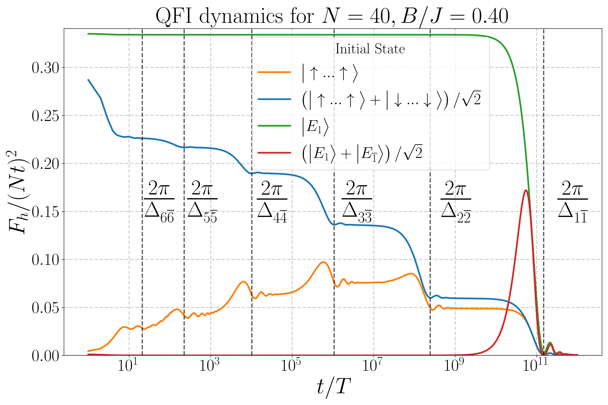

# QFI Dynamics in LMG Model

Simulation of Quantum Fisher Information dynamics in the Lipkin-Meshkov-Glick model. See paper: https://arxiv.org/abs/2505.22731

```math
\hat{H}(t) = -\frac{2J}{N} \hat{S}_z^2 - 2 B \hat{S}_x - \pi \sum_{m=1}^{\infty} \delta(t - mT) \hat{S}_x + \hat V(t)
```




## Installation

Requires [uv](https://docs.astral.sh/uv/):
```bash
conda env create -f environment.yml
# activate env 
conda activate lmg_qfi
uv sync
```

## Usage

```bash
# Run simulation for all initial states
uv run python quantum_fisher_information_simulation_mpmath.py

# Run for specific initial state (GS_phys, GS_cat, CatSum, Phys)
uv run python quantum_fisher_information_simulation_mpmath.py --init-state GS_phys

# Custom parameters
uv run python quantum_fisher_information_simulation_mpmath.py --system-size 20 --x-coupling 0.4

# Generate plot from existing results
uv run python quantum_fisher_information_simulation_mpmath.py --plot
```


## QuSpin Solver (fast double-precision alternative)

The QuSpin-based solver uses [QuSpin](https://quspin.github.io/QuSpin/) to build spin operators and
`scipy`/`numpy` for time evolution. It implements the same Floquet algorithm as the mpmath version
but runs ~800–1000× faster at double precision (dps=15).

### Installation

QuSpin is an optional dependency:

```bash
uv sync --extra quspin
# or add it directly
uv add quspin
```

### Running from the command line

```bash
# Run all 4 initial states (reads N, B, J, … from parameters.ini)
uv run python quantum_fisher_information_simulation_quspin.py

# Run a single initial state
uv run python quantum_fisher_information_simulation_quspin.py --init-state GS_phys

# Custom system size and transverse field
uv run python quantum_fisher_information_simulation_quspin.py --system-size 20 --x-coupling 0.4

# Generate plot from existing QuSpin CSV results
uv run python quantum_fisher_information_simulation_quspin.py --plot
```

Results are saved to `results/quspin.<state>_N=<N>_B=<B>.csv`.

### Running the solver-comparison script

```bash
# Compare all 4 initial states across 2000 time points (N=10, B=0.4 defaults)
uv run python compare_solvers.py
```

This runs QuSpin over 2055 log-spaced points (t=1 to 10⁶) and validates against mpmath on a
50-point sample, printing timing, per-state QFI tables, and relative errors.

### Library usage

```python
import numpy as np
from lmg_qfi.quspin_solver import get_spin_operators, build_h0, run_quspin_simulation

N, J, B = 10, 1.0, 0.4

Sz, Sx, Sy = get_spin_operators(N)
H0 = build_h0(J, B, N, Sz, Sx)

params = dict(
    N=N, J=J, B=B, T=1.0, nu=2, phi=np.pi, h=0.0,
    epsilon=1e-7, steps_floquet_unitary=10,
    varphi=0.0, theta=0.0, phi_0=0.0,
)

# Initial state: all spins up |N/2, N/2>
psi0 = np.zeros(N + 1, dtype=complex); psi0[0] = 1.0

time_points = list(range(1, 100)) + [200, 500, 1000]
results = run_quspin_simulation(params, time_points, psi0)

for r in results[:5]:
    print(f"t={r.time:4d}  QFI={r.qfi:.6e}  mz={r.m_z:.4f}")
```

### QuSpin solver tests

```bash
uv run pytest tests/test_quspin_solver.py -v
```

The test suite (53 tests) covers operator correctness, Floquet unitarity, QFI non-negativity,
and numerical agreement with the mpmath reference for N=20.

## Fortran solver (quadruple precision, OpenMP)

`fortran/` holds a parallel Fortran implementation of the mpmath simulation. It reads the same
`parameters.ini`, uses the same time grid and writes the same CSV columns, and it reproduces the
mpmath reference files in `results/` (to the last stored digit for N = 20 and N = 40). A run for
N = 50 with all four initial states takes a few seconds.

```bash
make -C fortran                                # needs gfortran and make
fortran/build/lmg_qfi --system-size 50 --steps 250 --num-points 300
uv run python quantum_fisher_information_simulation_mpmath.py --system-size 50 --plot
```

Results are saved to `results/fortran.<STATE>_N=<N>_B=<B>.csv`. Method, precision limits, validation
against the reference files and the Slurm batch scripts are described in
[fortran/README.md](fortran/README.md).

## SLD calibration mismatch

The symmetric logarithmic derivative (SLD) is a locally optimal observable. To
test calibration error, construct the canonical pure-state SLD at
`h_ref = 0.001`, then measure it on the state evolved at `h = 0`:

```math
\mathcal{M}_0[L_{h_{\rm ref}}]
=\left.\frac{\bigl(2\operatorname{Re}\langle\psi_h|L_{h_{\rm ref}}|
\partial_h\psi_h\rangle\bigr)^2}
{\langle L_{h_{\rm ref}}^2\rangle_h-\langle L_{h_{\rm ref}}\rangle_h^2}\right|_{h=0}.
```

The observable is held fixed when taking the derivative at the target field.
It is constructed separately for each initial state and time, so this study
does not assume a single time-independent measurement. The same initial ket
is used at both fields. The canonical choice is `L = 2 ∂ρ`, with a zero block
within the kernel of the calibration density matrix; other SLD extensions
can behave differently away from calibration.

The separate four-panel figure compares this sensitivity with the QFI at
`h = 0` and the matched observable `L_0`, which provides the local saturation
check. All curves use the common normalization `(N t)^2`.

```bash
uv run python scripts/plot_sld_mismatch.py --check-convergence
```

The defaults are `N=10`, `B/J=0.4`, 50-digit arithmetic, 100 integration
steps per kick period, and integer times through `t/T=10000`. The grid
combines logarithmic sampling with a maximum five-period spacing.
CSV data, numerical diagnostics in JSON, and a 300-dpi PNG with a vector PDF
are written to `results/sld_mismatch/`. `--check-convergence` compares selected
times at 60 digits and at 200 integration steps. `--steps`, `--dps`,
`--h-reference`, `--h-target`, and `--output-dir` allow separate studies.
The original N=10 MoM files used only 10 integration steps; the new study
recomputes its own target QFI for a consistent comparison.

For the committed run, the matched SLD agrees with QFI to better than
`9e-48` relative error, and no calibrated MoM value exceeds the target QFI.
The 50- and 60-digit checks give identical stored double-precision values.
At the eight checked times, doubling the integration steps changes the
normalized sensitivities by at most 1.03% of each state's peak normalized
QFI. This is a discretization check, not a uniform relative-error bound at
small sensitivities or a continuum-limit extrapolation.

## Tests

```bash
uv run pytest tests/ -v                    # Run all tests
uv run pytest tests/test_operators.py -v   # Run specific module
uv run pytest tests/ -v --cov=lmg_qfi      # With coverage
```


## Library Usage

```python
from lmg_qfi import (
    create_hamiltonian_h0,
    create_spin_xyz_operators,
    run_simulation,
    InitialState,
    SimulationParams,
)
import mpmath as mp

H = create_hamiltonian_h0(J=1.0, B=0.4, num_spins=10)
Sz, Sx, Sy = create_spin_xyz_operators(n=10)

params = SimulationParams(
    run_arguments={"dps": 50, "steps_floquet_unitary": 100, "num_points": 50},
    N=10,
    J=mp.mpf(1.0),
    B=mp.mpf(0.4),
)
results = run_simulation(params, [InitialState.GS_CAT])
```
